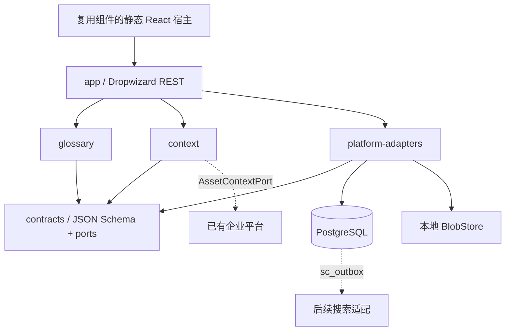

# 术语库与 AI 上下文中心拆分验证版

基于 OpenMetadata **2.0.8-release**（`dd013e20428ae77fb837332fb646d9b01301ed81`）。后端使用 **JDK 21、Dropwizard、JDBI、PostgreSQL**；前端复用 OpenMetadata 的组件、类型、主题和中英文词条，构建为静态资源，随 Java 应用在 **8585** 端口提供。

这是第一轮可运行的模块拆分，便于验证功能边界和后续接入已有平台。分支保留完整上游源码作为对照，独立应用只构建本目录的后端模块和共享 UI 组件。后端不依赖 `openmetadata-service`、原 `EntityRepository`、Airflow、RDF 或原 OpenMetadata 进程。

## 已实现的范围

| 模块 | 本轮能力 | 后续接入 |
| --- | --- | --- |
| 术语库 | 创建、编辑、软归档；术语树、层级移动、FQN 重命名级联；同义词、外部引用、双向 `relatedTo`；标签互斥校验、历史版本、并发冲突检测 | 自定义关系类型、CSV/本体导入导出、资产标注、审批 |
| 文章 | 创建、编辑、归档、历史版本；API 支持父子层级 | 原富文本整页、审批、评论与活动流 |
| 记忆 | 问答管理、私有/组织/指定人员共享、Viewer/Editor；列表、详情、历史和上下文组装统一鉴权；来源文档版本留存 | 现有用户/团队/域目录、自动提炼与审核 |
| 文档 | UTF-8 TXT/MD/CSV/JSON 上传与文本提取；5 MiB 上限；不可变内容版本、下载、替换与归档 | PDF/Office 提取、目录、批处理、现有对象存储 |
| AI 上下文 | 显式选择术语/文章/记忆/文档，按字符预算组装 Markdown；返回来源、实体版本、文件内容版本；术语和文章的关键词查找 | 语义检索、向量索引、模型调用、Persona 与资产结构/血缘/DQ 提供器 |

本体浏览器和 MCP 本轮未迁移。`GET /api/v1/capabilities` 返回实际支持状态。审批请求返回 `501`，没有配置的资产提供器也返回 `501`。当前上下文预览是新宿主入口，复用 2.0.8 的预算与文本清理逻辑，并非声称 2.0.8 原有同名整页。

原页面依赖全站路由、权限提供器、用户目录和资产搜索，因此这轮先迁移独立展示/编辑组件，配精简宿主。具体来源与修改见 [SOURCE_MANIFEST.md](SOURCE_MANIFEST.md) 和 [SOURCE_MANIFEST.json](SOURCE_MANIFEST.json)。完整术语页、富文本编辑器和文档管理整页仍在后续迁移清单中。

## 启动

依赖：JDK 21、Maven 3.9+、Node 22.23.4+、Yarn 1.22、PostgreSQL 15。后端与前端均从源码构建，Docker 仅用于数据库。

```bash
cd standalone/semantic-context
export SCM_DB_PASSWORD='替换为本机开发密码'
docker compose -f compose.dependencies.yml up -d
bash scripts/build.sh
bash scripts/run.sh
```

然后在**运行应用的同一台机器**访问 `http://127.0.0.1:8585`。云端运行时，需要通过云环境提供的端口转发访问；客户端的 `127.0.0.1` 指向客户端本机。

已有 PostgreSQL 时，创建独立的 `semantic_context` 数据库，并设置：

```bash
export SCM_JDBC_URL='jdbc:postgresql://127.0.0.1:5432/semantic_context'
export SCM_DB_USER='semantic_context'
export SCM_DB_PASSWORD='你的数据库密码'
bash scripts/run.sh
```

应用以 `sc_` 前缀初始化自己的表，保留实体、历史、事务锁和索引事件 outbox。这里使用新的存储适配，不直接接管 OpenMetadata 的原数据库表。数据库与 `.runtime/blobs` 需要一起持久化和备份。

开发配置仅向回环地址提供免令牌身份。需要对外开放时，设置 `SCM_BIND_HOST=0.0.0.0`、`SCM_API_TOKEN`，并使用 `SCM_CONFIG=config/production.example.yaml`。页面支持输入配置的令牌；生产接入应替换为已有平台的 JWT/SSO 和权限适配。

## 验证

本轮结果：13 项后端集成测试、3 项 Chromium 流程测试及 PostgreSQL 重启恢复检查通过，见 [验证记录与截图](docs/VALIDATION.md)。

```bash
# 独立后端：真实 HTTP、SQL 事务和本地文件，不启动原 OpenMetadata
mvn -f pom.xml spotless:check test

# 静态前端类型与 lint
yarn --cwd frontend run lint

# 应用启动后，运行浏览器流程测试
SCM_BASE_URL=http://127.0.0.1:8585 yarn --cwd frontend run test:e2e

# 检查从上游复制的来源、版本和当前文件哈希
python3 scripts/verify_manifest.py
```

测试使用的 `fixture-*` 令牌仅存在于测试配置。构建产物、依赖、运行配置、上传文档和数据库数据均不提交。浏览器测试可通过 `SCM_CHROMIUM_PATH` 指定已安装的 Chromium。

## 模块边界



`contracts` 内嵌从 2.0.8 递归选取的 23 个 JSON Schema。请求按原 Schema 校验，实体 JSON 保留原字段形状，并增加 `revision` 和来源版本记录；生成的上游 TypeScript 类型原样保留。业务仓储重新适配为小型独立实现，没有搬入整个 OpenMetadata 内核。

接口差异、当前容量边界和分阶段接入计划见 [docs/EXTRACTION.md](docs/EXTRACTION.md)；主要接口见 [docs/API.md](docs/API.md)。
